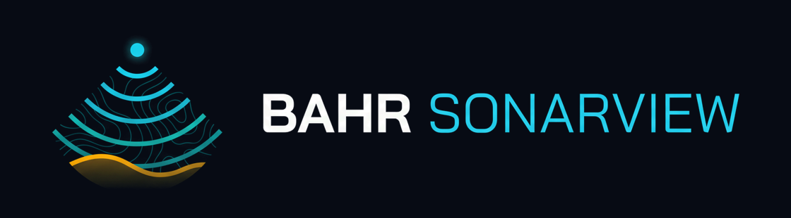

<p align="center"></p>

# BAHR SONARVIEW

Garmin balık bulucu sonar kayıtları (`.RSD`) için masaüstü analiz programı. Bir sonar kaydını yükle; derinlik haritası, canlı sonar kesiti, zemin sınıflaması, gölet hacmi, yeni tarama rotası, balık / nesne taramaları ve tek dosyalık rapor üretir.

## İndir ve çalıştır (Windows 10/11)

1. [Releases](../../releases) sayfasından `BAHR_SONARVIEW-windows.zip` dosyasını indir.
2. Zip'i bir klasöre çıkar.
3. `BAHR SONARVIEW\BAHR SONARVIEW.exe` dosyasına çift tıkla.

Python ya da başka bir kurulum gerekmez. Program kendi penceresinde açılır; veriler bilgisayarda kalır (yalnızca uydu altlığı için internet kullanılır). Ayrıntılı kullanım: [BAHR_SONARVIEW/OKU_BENI.md](BAHR_SONARVIEW/OKU_BENI.md).

## Neler yapar

| Analiz | Çıktı |
|---|---|
| Temel (otomatik) | Rota, derinlik haritası, eş derinlik çizgileri, sonar görüntüleri, grafikler, **kot–alan–hacim tablosu**, **belirsizlik haritası** |
| Zemin sınıflaması | Dip yankısının genlik şeklinden (sertlik, penetrasyon, sönümlenme) göreli zemin sınıfları, dip numunesi noktaları (GPX) |
| Uydu, hacim ve rota | Uydudan kıyı çizgisi, toplam hacim, dip eğimi, kapsama, eksik alanlar için tarama rotası (GPX) |
| Su kolonu ve dip taramaları | Balık ve gaz kabarcığı izleri, kaya / batık nesne, su bitkisi örtüsü |
| Doğrulama ve kalibrasyon | Saha derinlikleri ve dip numuneleriyle karşılaştırma (RMSE), kalibrasyon ve zemin sınıfı adı önerisi |
| Değişim analizi | İki tarih arasında dip kotu farkı, sediman birikimi / oyulma haritası, yıllık m³ |
| Mühendislik çıktıları | GeoTIFF, Shapefile, GeoJSON, KML, DXF (R12), XYZ — WGS84 / UTM, **TUREF (ITRF96) / TM 3°**, ED50 |
| Rapor | Kapaklı (firma, logo, imza alanları) PDF ve HTML rapor |

Arayüzde: **3B topografya (yalnızca seçilen alan; PNG / OBJ / STL)**, uydu haritası ve katmanlar, mesafe / alan ölçümü, derinlik profili, harita notları, kayıt boyunca gezinilebilen sonar görüntüleyici ve **dip çizgisini elle düzeltme**, bir projede birden çok RSD kaydı, ses hızı / batma payı / su yüzeyi kotu ayarları, analiz iptali, anlaşılır hata mesajları ve hata raporu, Türkçe / English, m / ft, program içi yardım, otomatik güncelleme.

**Sınırlar:** Yalnızca Garmin `.RSD` (aşağı bakan DownVü kanalı). Zemin, balık ve bitki sonuçları kalibre edilmemiş bir balık bulucudan elde edilen **göreli** sonuçlardır; kesin zemin tipi için dip numunesi gerekir.

## Depo yapısı

```
BAHR_SONARVIEW/        Masaüstü programı
  kaynak/              bahr_sonarview.py (pencere), sunucu.py, motor/ (analiz), static/ (arayüz)
  derle.bat            .exe derlemesi (PyInstaller)
  run.bat              derlenmiş programı başlatır
sonarlab/              Aynı uygulamanın tarayıcıda çalışan sürümü (FastAPI)
*.py (kök)             İlk keşif ve analiz betikleri (tek kayıt üzerinde)
```

## Kaynaktan çalıştırma / derleme

```
py -m venv .venv
.venv\Scripts\python -m pip install -r BAHR_SONARVIEW\kaynak\gereksinimler.txt
.venv\Scripts\python BAHR_SONARVIEW\kaynak\bahr_sonarview.py      # geliştirme kipinde aç
BAHR_SONARVIEW\derle.bat                                          # .exe derle
```

RSD dosyaları [PINGVerter](https://github.com/CameronBodine/PINGVerter) ile çözülür. Harita: [Leaflet](https://leafletjs.com), grafikler: [Chart.js](https://www.chartjs.org), uydu altlığı: Esri World Imagery.
